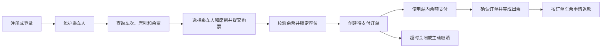
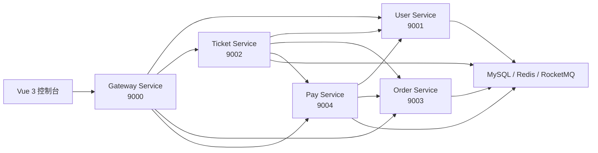

# Index12306 铁路购票系统

Index12306 是一个基于 Java 17、Spring Boot、Spring Cloud Alibaba 和 Vue 3 构建的微服务铁路购票项目，包含用户注册、乘车人管理、车票查询、购票下单、订单支付、取消订单和退票等完整业务。

## 项目能力

### 基础铁路购票

- 用户注册、登录、退出、资料维护、账户注销和站内余额管理。
- 乘车人新增、修改、删除与当前用户乘车人列表查询。
- 按出发地、目的地和乘车日期查询车次、席别、价格与余票。
- 购票参数校验、余票令牌预扣、座位选择与锁定、订单创建及库存更新。
- 本人订单分页查询、订单详情查询、未支付订单关闭与取消。
- 基于服务端订单金额的站内余额支付、支付记录查询和订单支付确认。
- 已支付车票退款、退款记录落库、余额退回与座位资源释放。
- 使用限流、风控、分布式锁、幂等控制和延迟消息保护高并发购票链路。

## 基础购票流程

传统页面复用相同的业务服务，基础购票流程如下：



购票请求进入 `ticket-service` 后，会先完成参数与乘车人校验，再通过余票令牌、分布式锁和座位位图控制并发分配，随后调用 `order-service` 创建订单。`pay-service` 根据服务端订单数据确定支付金额，完成余额扣减并确认订单；未支付订单可由延迟消息关闭，取消或退款后由票务服务释放座位并回补余票资源。

## 系统架构



## 模块职责

| 模块 | 默认端口 | 主要职责 |
| --- | ---: | --- |
| `gateway-service` | 9000 | 统一入口、路由转发和登录态上下文传递 |
| `user-service` | 9001 | 用户、乘车人和站内余额管理 |
| `ticket-service` | 9002 | 车次余票查询、座位分配、购票、取消和退票编排 |
| `order-service` | 9003 | 订单及子订单创建、查询、关闭、取消和支付状态维护 |
| `pay-service` | 9004 | 站内余额支付、支付单查询、退款和余额回补 |
```text
index12306
├── services                    # 传统铁路购票微服务
├── frameworks                  # 公共 Spring Boot Starter
├── console-vue                 # Vue 3 购票页面
├── resources_sql_sharded       # 业务数据库初始化及升级 SQL
└── docs                        # 项目文档
```

## 环境要求

- JDK 17
- Maven Wrapper（仓库已包含）
- Node.js、Yarn
- MySQL
- Redis
- Nacos
- RocketMQ

## 数据库与关键配置

### 基础业务数据库

`resources_sql_sharded` 提供了传统购票业务所需的建表、基础数据和升级脚本：

- `ticket-service` 使用单库 `12306_ticket`。
- `user-service` 使用分片库 `12306_user_0`、`12306_user_1`。
- `order-service` 使用分片库 `12306_order_0`、`12306_order_1`。
- `pay-service` 使用分片库 `12306_pay_0`、`12306_pay_1`。
- 全新环境先导入 `resources_sql_sharded/db`，再导入 `resources_sql_sharded/data`。
- 已有数据库根据实际版本按需执行 `resources_sql_sharded/upgrade` 中的升级脚本。

启动前需要检查各服务的 `application.yaml` 和 `shardingsphere-config.yaml`，将 MySQL、Redis、Nacos、RocketMQ 地址及账号密码调整为本地环境配置。

## 本地启动

### 基础购票模式

1. 启动 MySQL、Redis、Nacos 和 RocketMQ。
2. 按前述顺序初始化业务数据库并修改各服务连接配置。
3. 启动 `user-service`、`order-service`、`pay-service` 和 `ticket-service`。
4. 启动 `gateway-service`。
5. 启动前端：

```bash
cd console-vue
yarn install
yarn serve
```

登录后可以通过以下页面完成传统购票操作：

- `/ticketSearch`：查询车次和余票。
- `/passenger`：管理乘车人。
- `/buyTicket`：确认乘车人和席别并提交订单。
- `/order`：查看和处理订单。
- `/myTicket`：查看本人车票。

## 构建与测试

编译整个 Maven 工程：

```powershell
.\mvnw.cmd -DskipTests package
```

运行传统购票服务测试：

```powershell
.\mvnw.cmd -pl services/user-service,services/ticket-service,services/order-service,services/pay-service -am test
```

构建前端：

```bash
cd console-vue
yarn build
```

## 可观测性

传统业务服务集成了 Spring Boot Actuator 和 Prometheus 指标注册器，可按各服务配置查看健康状态与运行指标。

## 安全与一致性

- 车票查询和下单接口按用户或 IP 维度执行限流与风控校验。
- 购票链路通过余票令牌、分布式锁和座位位图降低超卖风险。
- 支付金额从订单服务端数据生成，不接受客户端指定金额。
- 用户订单查询、取消和退款均校验当前登录用户与订单归属。
- 余额扣减、余额退回和关键写操作使用业务标识保证幂等。

## 许可证

本项目遵循仓库 [LICENSE](LICENSE) 中声明的开源许可证。
